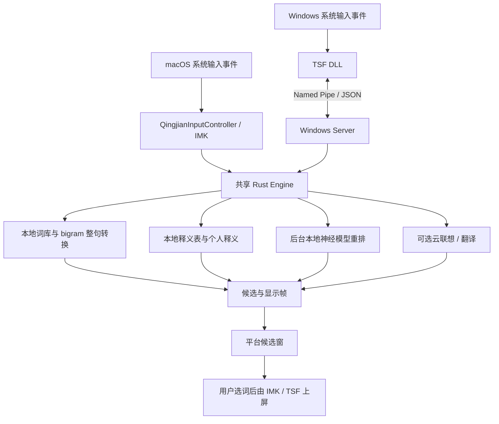

# 青简 v0.2.1：REA 发布包逆向与源码交叉分析

分析日期：2026-10-18（北京时间）。目标：[qingjian-team/qingjian](https://github.com/qingjian-team/qingjian)，工具：[morluto/rea](https://github.com/morluto/rea)，REA **6.5.0**，独立 Node **24.22.0**。

青简的主体是 **Rust 本地拼音引擎 + 本地词库/释义表 + 异步本地模型重排 + 可选云联想**。macOS 用 InputMethodKit，Windows 用 TSF DLL 与独立 Server。候选旁的译词主要查本地数据，并不要求每次击键调用大模型。

本次实际下载并解包 macOS ARM64 发布包，运行 REA，再对照同版本源码追踪行为。Windows 部分为源码分析。没有运行安装器、注册输入源、切换用户输入法或修改 Lucid 业务代码。

## 1. 目标身份与证据边界

| 项目 | 实际结果 |
| --- | --- |
| 发布版 | `v0.2.1`，2026-10-14 发布；本次读取时的最新稳定版 |
| 源码提交 | `f65ea74c9d631f9a7fd47b8725415a88577f80d2`，与 `v0.2.1^{}`、官方 `build-info.json` 一致 |
| 安装包 | `qingjian-0.2.1-macos-arm64.pkg`，152,374,451 字节 |
| 包 SHA-256 | `7b3c23361642d59bb914c89a5ab3314a3ff4eb40e71e5242e54ec4467c5cb633`，与官方 `SHA256SUMS` 相符 |
| 主程序 | `Qingjian.app/Contents/MacOS/qingjian-macos`，21,192,944 字节，ARM64 / 64 位 / little-endian Mach-O |
| 主程序 SHA-256 | `62f6de6a59a0606f1be24da35c1a9118e0bf73ba565b422b3757b5bb09949350` |
| Bundle | `app.qingjian.inputmethod`，版本 `0.2.1`，build `369`，`LSBackgroundOnly=true` |
| 安装位置 | 包的 `PackageInfo` 指定 `/Library/Input Methods`，要求 root |
| 系统版本 | `Info.plist` 要求 macOS 13.0；Mach-O 的 `LC_BUILD_VERSION` minimum OS 为 11.0。两者是不同层面的声明，不能据后者断言支持 macOS 11 |
| 签名 | `pkgutil` 报安装包无签名；`codesign` 报 app 为 ad hoc，未设置 TeamIdentifier |
| 包内容 | 独立文件清单共 41 个普通文件，合计 252,363,958 字节；其中 21 个 `.qj` / `.qjm` 容器 |

下载与校验对应官方发布记录，不能单凭哈希相符证明供应链安全或构建可复现。源码对应关系依赖官方构建元信息，并非本次重新构建后逐字节比较。

当前 main 为 `c97ff2b61933d6fcd845ee4f4f470faf3ea83bf6`，与发布版已有明显差异，尤其独立设置程序、Windows 云候选流程。本报告的实现结论固定到上述发布提交。

证据文件：

| 文件 | 来源与用途 |
| --- | --- |
| [macho-input.json](evidence/macho-input.json) | REA `inspect-macho`：架构、依赖、入口、段、符号；Evidence `ev_207a95d7cd299e307b56a1275f378af4d0ea3c2434e3210023fe4c947c2d62c3` |
| [rust-input.json](evidence/rust-input.json) | REA `inspect-rust-binary`；Evidence `ev_4c9bf18b4d3e360ed013b6ccdab6480ba5e6650f750577a06f54b6735866b85f` |
| [artifact-app.json](evidence/artifact-app.json) | REA `inspect-artifact`，包含目录图；Evidence `ev_7677d3082ea4c9ae2fa919c66ccd2a1033262150d3538d5d821f0b5c611725d0` |
| [resources.json](evidence/resources.json) | 自编 Python 解析结果：全部文件哈希、plist、容器分节、模型配置、权重元素计数、字符串文件偏移。**这是独立静态观察，不是 REA Evidence** |
| [build-info.json](evidence/build-info.json)、[SHA256SUMS](evidence/SHA256SUMS) | 官方发布附件原文 |
| [verification.json](evidence/verification.json) | 本次身份一致性、模型哈希与证据交叉校验结果 |

本机没有 Hopper / Ghidra / IDA，因此没有原生函数反编译、调用图恢复或动态抓包。REA 的 Mach-O 导入、导出结果标明不保证穷尽；Rust 检查未找到 `.dep-v0`，**不能从该结果恢复完整依赖版本表**。REA 观察到的只读路径含 rustc commit `ac68faa20c58cbccd01ee7208bf3b6e93a7d7f96`，与官方工具链声明相符，但属于推断。

## 2. 总体调用链

macOS 的 Host 是主线程 `thread_local! RefCell<Option<Host>>`，共享一个 Engine、候选窗和当前会话显示状态；并非每个 IMK 控制器都持有一套独立引擎。Windows 的 DLL 只保留 TSF/COM 与文档编辑边界，Engine 和候选窗在 Server。

## 3. macOS：最值得研究的部分

### 3.1 类注册必须先于 IMKServer

启动时先调用 `QingjianInputController::class()`，然后初始化 Host、创建 `IMKServer`，最后进入 `NSApplication.run()`。源码明确指出：`objc2::define_class!` 延迟注册类，若 IMKServer 先按 plist 查找控制器，可能退回基类并表现为按键透传。

发布包的 plist 指定 `InputMethodServerControllerClass=QingjianInputController`、连接名 `app.qingjian.inputmethod_Connection`。二进制确实含控制器名、`objc_allocateClassPair`、`objc_registerClassPair`。这些静态事实与源码一致；本次未观察实际注册调用执行。

源码：[main.rs:61](https://github.com/qingjian-team/qingjian/blob/f65ea74c9d631f9a7fd47b8725415a88577f80d2/apps/macos/src/main.rs#L61)。

### 3.2 统一按键入口与焦点生命周期

青简实现 `handleEvent:client:`，在内部按事件类型、键码、修饰键区分文本、命令和快捷键。该版本未声明两种 `inputText` 回调。二进制精确字节搜索找到 `handleEvent:client:` 于文件偏移 `0xec2c33`；未找到 `inputText:client:` 或 `inputText:key:modifiers:client:`。字符串存在/缺失只能佐证此实现选择，不能单独证明运行时方法表或 ABI 正确性。

`activateServer:` 更新应用身份与配置；`deactivateServer:` / `commitComposition:` 处理剩余拼音、取消云候选、隐藏窗口。切换输入源时还打断学习上下文并刷盘。ObjC 回调用 `catch_unwind` 拦截 Rust panic，尝试把缓冲字母原样上屏后清空状态。

源码：[controller/mod.rs:55](https://github.com/qingjian-team/qingjian/blob/f65ea74c9d631f9a7fd47b8725415a88577f80d2/apps/macos/src/imk/controller/mod.rs#L55)、[imk/mod.rs:18](https://github.com/qingjian-team/qingjian/blob/f65ea74c9d631f9a7fd47b8725415a88577f80d2/apps/macos/src/imk/mod.rs#L18)。

### 3.3 跨进程读写期间可能重入

读取应用文本、获取光标位置、插入文字都可能让 IMK 在等待应用响应期间处理别的回调。因此青简采用“读取策略 → 释放 Host 借用 → 调用文本客户端 → 重新借用 Host 更新状态”的顺序；`Host::with` 也用 `try_borrow_mut` 处理重入。

这比单纯使用互斥锁更关键：主线程上的跨进程调用仍可能引发重入。不能因函数运行在主线程就认为持有可变借用安全。

源码：[host/mod.rs:221](https://github.com/qingjian-team/qingjian/blob/f65ea74c9d631f9a7fd47b8725415a88577f80d2/apps/macos/src/host/mod.rs#L221)、[display.rs:95](https://github.com/qingjian-team/qingjian/blob/f65ea74c9d631f9a7fd47b8725415a88577f80d2/apps/macos/src/imk/controller/display.rs#L95)。

### 3.4 文本访问与确认替换

`TextClient` 封装 `setMarkedText:selectionRange:replacementRange:`、`insertText:replacementRange:`、`selectedRange`、`attributedSubstringFromRange:` 与光标矩形读取。云联想读取光标前后文，应用不支持时退回 Engine 的本地历史；Secure Input 开启时不发起联想或选区翻译。

选区翻译最多接收 500，实际前置判断按 `NSRange.length`，所以这里的限制单位更接近 UTF-16 code units；UI 文案称“500 字”。翻译结果由用户按回车、空格或 1 确认，Esc 放弃。

**不能直接拿来替代 Lucid 的替换校验**：青简 `TranslationJob` 只保存原选区范围和结果，确认路径直接 `replace_range`，本条路径未见对原文再次逐字比较。跨应用、焦点切换、选区被其他事件改变后的完整安全性没有由本次静态分析证明。Lucid 当前已有原文/范围/替换后内容校验，应保留。

源码：[client.rs](https://github.com/qingjian-team/qingjian/blob/f65ea74c9d631f9a7fd47b8725415a88577f80d2/apps/macos/src/imk/client.rs)、[translate.rs:63](https://github.com/qingjian-team/qingjian/blob/f65ea74c9d631f9a7fd47b8725415a88577f80d2/apps/macos/src/imk/controller/translate.rs#L63)、[translation_job.rs](https://github.com/qingjian-team/qingjian/blob/f65ea74c9d631f9a7fd47b8725415a88577f80d2/apps/macos/src/host/presenting/translation_job.rs)。

### 3.5 候选窗与全屏 Space

使用无边框、非激活 `NSPanel`，透明背景，不因宿主应用失活而隐藏；设置 `CanJoinAllSpaces | FullScreenAuxiliary | Stationary`，并在最后设置窗口层级。青简渲染器画出位图与点击区域，平台层展示；还保留系统绘制路径。

值得参考的兼容性措施：显示后检查 `isOnActiveSpace()`，若窗口仍未归属当前 Space，创建新面板并迁移内容视图。源码将其用于 macOS 26 新建全屏 Space 后候选窗留在桌面的情况。定位优先使用光标矩形，失败时使用鼠标所在屏幕，再做边界夹紧。

这是源码中的防御策略，本次没有在全屏应用里复现和验证。

源码：[window.rs:94](https://github.com/qingjian-team/qingjian/blob/f65ea74c9d631f9a7fd47b8725415a88577f80d2/apps/macos/src/candidates/window.rs#L94)。

## 4. 发布包中的词库、释义与本地模型

`.qj` 使用 `QINGJIAN` 魔数、32 字节头、24 字节分节表项、8 字节正文对齐；`.qjm` 使用相同容器，kind=6。模型容器包含 `META / CONF / VOCB / SAFT`，`SAFT` 是 safetensors。独立解析器检查了分节范围、对齐、重叠与每个张量形状/数据范围。

| 文件 | 发布包观察 |
| --- | --- |
| `dict.qj` | META 声明 132,884 条基础词条，4,289,288 字节 |
| `dicts/*.qj` | 11 份领域词库，涉及动物、汽车、财经、饮食、历史、成语、计算机、法律、医学、地名、诗词 |
| `lm.qj` | 44,798,744 字节；META 声明 4,913,987 条，属于 bigram 数据，不应称作 491 万词词库 |
| `glossary-en.qj` | META 声明 232,213 条释义 |
| `glossary-ja.qj` | META 声明 248,128 条释义 |
| 其他释义表 | 西班牙语、越南语、德语、中文均有实际 `.qj` 文件 |
| 含章·通变 | 46,141,208 字节；100 个 F16 张量，共 **23,037,056** 个参数元素；vocab=8,180 |
| 含章·知微 | 56,044,208 字节；100 个 F16 张量，共 **27,950,272** 个参数元素；vocab=19,147 |

两个模型的 CONF 均为 8 层、448 隐藏维、8 个注意力头、128 上下文长度、tied embeddings。参数数量由实际 safetensors shape 累加，和 META 相符；词条数来自文件自带 META，未重新枚举去重证明语义条数。

两份模型文件 SHA-256 分别与官方 `p2c_model_sha256`、`model_sha256` 一致。**不是两个模型串联调用**：macOS 加载路径优先选通变 P2C；路径不存在时才选知微字级模型。通变文件存在但加载失败的路径会降级为无本地重排，本段代码没有自动再尝试知微。

macOS 在后台加载并预热，成功后用非阻塞接收接入 Engine；停键防抖 80 ms，结果轮询 20 ms，兜底等待 2 s。这些是源码常数，不是本次性能实测。

源码：[format/header.rs](https://github.com/qingjian-team/qingjian/blob/f65ea74c9d631f9a7fd47b8725415a88577f80d2/crates/qingjian-format/src/layout/header.rs)、[neural/qjm.rs](https://github.com/qingjian-team/qingjian/blob/f65ea74c9d631f9a7fd47b8725415a88577f80d2/crates/qingjian-neural/src/qjm.rs)、[host/model/mod.rs:20](https://github.com/qingjian-team/qingjian/blob/f65ea74c9d631f9a7fd47b8725415a88577f80d2/apps/macos/src/host/model/mod.rs#L20)、[rescore_monitor.rs:10](https://github.com/qingjian-team/qingjian/blob/f65ea74c9d631f9a7fd47b8725415a88577f80d2/apps/macos/src/host/model/rescore_monitor.rs#L10)。

## 5. 安装与设置的发布版差异

v0.2.1 包里没有独立 settings 可执行程序。设置由 `apps/macos/src/preferences` 的原生窗口承载；不要把 main 分支的新 `apps/settings` 当成这个安装包的结构。

包的 postinstall 会终止旧输入法进程，以登录用户会话运行 `qingjian-macos --register`，还会删除该用户的部分 `IntlDataCache` 文件。这里仅阅读脚本，没有执行。分析该流程对理解“安装完成但系统不分发按键”的问题有帮助；不宜仅因参考项目这样做就向 Lucid 引入广泛缓存删除。

源码：[postinstall:10](https://github.com/qingjian-team/qingjian/blob/f65ea74c9d631f9a7fd47b8725415a88577f80d2/apps/macos/pkg/scripts/postinstall#L10)。

## 6. Core：一次按键如何变成候选

源码中的 `Engine` 是平台无关的唯一门面，包含词库、语言模型、释义、学习、预测器、模型重排器和会话状态。它是 `Send` 而不是 `Sync`：同一个 Engine 由一个线程独占，平台壳通过消息或主线程轮询把工作交给它；每个输入上下文的会话状态可以整体换出。这个约束比“给 Engine 加锁然后多线程共享”更接近青简的实际设计。

一次拼音查询大致经过以下顺序：

1. 先解双拼或注音，解析全拼、简拼和末尾未完成音节，最多保留 8 种切分。
2. 词级查询合并基础词库、领域词库和用户词库；完整音节和末尾前缀都可产出候选。
3. 整句路径把各位置的词放进词图，用 Viterbi/束搜索结合静态 bigram 与个人 n-gram；纠错变体主要进入整句词图，不直接扩展普通词级候选。
4. 取最多 6 条整句路径供神经重排，候选总量上限为 500；重排结果只改变顺序，不写回静态路径分。
5. 最后再加入英文、emoji、颜文字、符号、个人短语和译词标注，并根据繁体设置做转换。

“通变”是 P2C 模型，条件是用户实际按键，可以给整句路径打分，也可以用 beam search 直接由拼音生成整句；“知微”是字级上下文模型，条件是光标前文。模型加载需要壳显式接入，模型文件存在本身不代表每次按键都做了推理。发布版 macOS 壳会在后台加载并预热模型，停键后以 80 ms 防抖、20 ms 轮询、最多 2 秒等待模型结果。

本地重排采用“先返回静态候选、后台补分”的方式。返回结果必须同时匹配当前文本上下文、按键和分数数量，过期结果会丢弃；条件变化会清空神经分缓存。若候选含模型字表外字符，则整批保留静态排序。这些机制是比单纯增加模型更值得迁移到 Lucid 的部分。

源码：[core-internals.md](https://github.com/qingjian-team/qingjian/blob/f65ea74c9d631f9a7fd47b8725415a88577f80d2/docs/design/core-internals.md)、[parser/mod.rs](https://github.com/qingjian-team/qingjian/blob/f65ea74c9d631f9a7fd47b8725415a88577f80d2/crates/qingjian-core/src/parser/mod.rs)、[rescoring/mod.rs](https://github.com/qingjian-team/qingjian/blob/f65ea74c9d631f9a7fd47b8725415a88577f80d2/crates/qingjian-core/src/engine/rescoring/mod.rs)、[core_scorer.rs](https://github.com/qingjian-team/qingjian/blob/f65ea74c9d631f9a7fd47b8725415a88577f80d2/crates/qingjian-neural/src/core_scorer.rs)。

## 7. 云联想、释义与隐私边界

Core 自身不联网，网络能力通过 `Predictor` trait 注入。云联想默认关闭；接入云实现后，仍然只作为异步补充，不参与本地排序，也不阻塞按键。默认防抖 300 ms，网络请求最短间隔 3 秒，最多携带 64 个字符前文、32 个字符后文、5 个本地候选提示，云词槽位为 2。

私密输入、辅码态、英文/表达式/原样输入和过短拼音不会发云联想。worker 会合并等待期内的新请求，只发送最新请求；已经进入 HTTP 调用的请求没有取消 token，但 Core 用递增序号丢弃旧结果。云词还会做字数、合法音节和编辑距离校验，账户失败会暂停 10 分钟。

译词优先使用本地 `.qj` 释义表和个人释义，个人释义覆盖随包释义。候选上屏后，只有当前语言不是中文、非私密输入且本地查不到时，才触发云端释义；云释义独立于云联想，最多攒 8 个词、等待 1.5 秒，并在同一进程内按语言和词缓存。

源码：[prediction/mod.rs](https://github.com/qingjian-team/qingjian/blob/f65ea74c9d631f9a7fd47b8725415a88577f80d2/crates/qingjian-core/src/engine/prediction/mod.rs)、[predict config](https://github.com/qingjian-team/qingjian/blob/f65ea74c9d631f9a7fd47b8725415a88577f80d2/crates/qingjian-predict/src/config.rs)、[commit/mod.rs](https://github.com/qingjian-team/qingjian/blob/f65ea74c9d631f9a7fd47b8725415a88577f80d2/crates/qingjian-core/src/engine/commit/mod.rs)。

## 8. Windows TSF：进程边界与实际风险

Windows 把 TSF DLL 放进宿主应用进程，因此 DLL 只负责 COM/TSF 适配、文档编辑和候选窗口坐标；唯一的 Core Engine 在独立 `qingjian-server` 进程中。两端通过 `\\.\pipe\qingjian` 命名管道通信，协议是 4 字节小端长度前缀加 JSON 消息。

按键路径是：`OnKeyDown` → `forward_key` → `EngineClient::key` → 写一帧并同步读取 Server 回包。管道和 `read_exact` 没有 IO deadline，所以“编辑会话异步”只表示 TSF 的 `RequestEditSession` 异步；按键转发本身仍可能同步等待 IPC。Server 为每个连接单独读管道，但所有会话最终进入一个串行 Router，某个会话的长任务可能延迟其他会话。

普通组句提交时，TSF 在写编辑会话中重新取得当前 composition range，用 `SetText` 替换并将选区折叠到末尾。断连后，DLL 会结束组句并在下一次按键时尝试重连。候选窗是 `NOACTIVATE`、`TOPMOST` 窗口，不抢宿主焦点；光标定位失败时会退到鼠标位置并修复异常矩形。

隐私边界在 DLL 和 Server 两侧都有：禁用键盘或没有上下文时放行；私密输入不读取光标前文并同步 private 状态；Server 只在普通 Medium integrity 宿主中自动启动。翻译选区存在一个需要特别注意的边界：Server 校验 session 与请求序号，但 DLL 没有保存原始 `ITfRange` 或原文快照，接受译文时使用当时的当前选区，因此源码没有证明等待期间选区变化时仍能安全阻止替换。

源码：[Windows 总览](https://github.com/qingjian-team/qingjian/blob/f65ea74c9d631f9a7fd47b8725415a88577f80d2/apps/windows/README.md)、[TSF README](https://github.com/qingjian-team/qingjian/blob/f65ea74c9d631f9a7fd47b8725415a88577f80d2/apps/windows/tsf/README.md)、[Server README](https://github.com/qingjian-team/qingjian/blob/f65ea74c9d631f9a7fd47b8725415a88577f80d2/apps/windows/server/README.md)、[协议 codec](https://github.com/qingjian-team/qingjian/blob/f65ea74c9d631f9a7fd47b8725415a88577f80d2/crates/qingjian-platform/src/protocol/codec.rs)。

## 9. 对 Lucid 最有价值的设计结论

- **平台壳与 Engine 分离。** 把 macOS IMK、Windows TSF 的文档编辑和候选窗定位限制在壳里，核心只处理输入状态、候选和提交结果。
- **单线程拥有 Engine。** 用消息传递和异步结果轮询处理并发，避免为查询缓存、会话状态和模型重排引入共享锁。
- **静态结果优先，模型异步重排。** 先保证每次按键有确定候选，再在上下文/按键双重校验后应用后台模型结果。
- **云功能注入且默认关闭。** 通过 trait 隔离网络，按私密状态、输入模式、最小长度和节流策略决定是否发送。
- **翻译提交必须保存上下文快照。** 青简 Windows 路径暴露了当前选区可能变化的风险；Lucid 的实现应继续保留原文、范围和替换前校验。
- **协议版本与枚举演进要一起管理。** Windows 协议是共享 JSON 类型，新增枚举变体可能令旧 DLL 整帧反序列化失败，因此协议版本必须与 DLL/Server 同步发布。

## 10. 未验证边界

本次没有在真实 macOS/Windows 输入框中安装、注册、切换输入法或运行端到端按键回放；没有 Windows 真机、Hopper/Ghidra/IDA、网络抓包或模型性能实测。因此已验证的是发布包静态结构、REA 证据、同版本源码路径和数据格式，不包括宿主兼容性、管道卡死恢复、翻译等待期间选区变化、云服务端行为、签名与安装升级行为。
